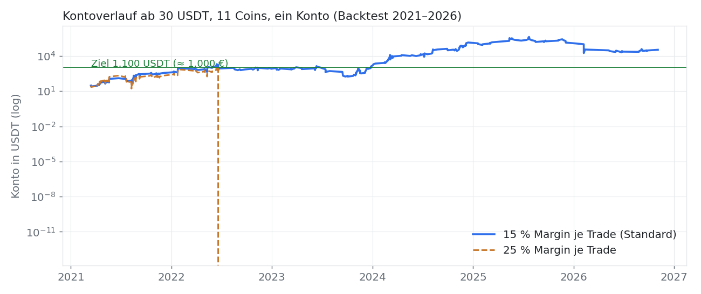

# 🎲 zockerbot – Rücksetzer im Ausbruch

<div align="center">


[](https://www.python.org/)


**Ein schneller Zocker-Bot mit fester Regel: Er kauft kurze Einbrüche in einem starken Tagesausbruch – und verkauft kurze Spitzen in einem starken Tageseinbruch. Hebel x20, Take-Profit +5 % Kurs, kein Stop-Loss.**

[Regel](#-die-regel) • [Wie sie gefunden wurde](#-wie-die-regel-gefunden-wurde) • [Ergebnisse](#-ergebnisse) • [Einsatzhöhe](#-einsatzhöhe) • [Ablauf](#-ablauf-im-live-betrieb) • [Installation](#-installation-minipc--vps) • [Bedienung](#%EF%B8%8F-bedienung) • [Risiken](#%EF%B8%8F-risiken)

</div>

---

## 🧭 Kurzfassung

- **Ziel:** aus einem kleinen Konto (z. B. 30 USDT) möglichst schnell etwa **1.000 €** machen.
- **Regel:** Stoch-RSI-, MACD-, EMA-, Bollinger-, Donchian-, Supertrend- und Volumen-Kombinationen wurden durchsucht – **übrig blieb genau eine Regel**, die in drei unabhängigen Prüfungen über der Gewinnschwelle lag.
- **Coins:** XRP, BTC, ETH, SOL, BNB, LTC, AVAX, ARB, AAVE, ADA, DOGE (USDT-Perpetuals auf Bitget).
- **Takt:** alle 15 Minuten, 20 Sekunden nach Kerzenschluss; nur abgeschlossene Kerzen.
- **Einsatz:** 15 % des Kontos als Margin pro Trade, x20, isoliert. Mehrere Coins können gleichzeitig offen sein.
- **Ausstieg:** nur Take-Profit bei +5 % Kurs (≈ +98 % auf die Margin). Ohne Stop-Loss – geht der Kurs ca. 4,5 % gegen die Position, wird die Margin dieses Trades liquidiert.
- **Live = Backtest:** `live.py` und `backtest.py` rufen dieselbe Funktion `strategy.signals()` auf.

---

## 📐 Die Regel

| | Long | Short |
|---|---|---|
| **Tageskerze** (UTC, abgeschlossen) | RSI(14) > 70 **und** Schluss über dem Hoch der 20 Tage davor | RSI(14) < 30 **und** Schluss unter dem Tief der 20 Tage davor |
| **15m-Kerze** (abgeschlossen) | RSI(14) < 30 | RSI(14) > 70 |
| **Einstieg** | Market zur Eröffnung der nächsten 15m-Kerze | ebenso |
| **Take-Profit** | Einstieg + 5 % | Einstieg − 5 % |
| **Stop-Loss** | keiner (Liquidation bei ca. −4,5 %) | keiner (Liquidation bei ca. +4,5 %) |

Pro Coin ist immer höchstens ein Trade offen.

**Warum das funktionieren kann:** Bricht ein Coin auf Tagesbasis kräftig aus (neues 20-Tage-Hoch, Tages-RSI über 70), wollen viele Marktteilnehmer noch hinein. Ein kurzer Einbruch auf 15m (15m-RSI unter 30) wird in dieser Lage oft schnell aufgekauft – der Kurs läuft häufiger erst 5 % in Trendrichtung, bevor er 4,5 % dagegen läuft. Spiegelbildlich im Crash.

---

## 🔬 Wie die Regel gefunden wurde

1. **Vorberechnet** wurde für jeden 15m-Zeitpunkt auf 8 Coins (2021–2026), ob Long bzw. Short zuerst den Take-Profit oder die Liquidation erreicht – auf **1-Minuten-Kerzen** geprüft, mit Gebühren und Funding. Getestet: x20 mit TP +2,5 / +5 / +10 % und x10 mit TP +5 / +10 %.
2. **Durchsucht** wurden **39.773 Kombinationen** aus bis zu drei Bedingungen (RSI, Stoch RSI, MACD, EMA-Trend, Bollinger, Donchian, Supertrend, Volumen auf 15m, 1h, 4h, 1d) – jeweils Long, Short und beide Richtungen.
3. **Ausgewählt** wurde nur auf **2021–2023**, geprüft auf **2024–2026**. Ergebnis: Die besten 20 aus 2021–2023 verloren danach **ausnahmslos** (das frühere Erfolgsrezept „15m unter dem Bollinger-Band kaufen“ kippte).
4. **Gegenprobe auf drei ungesehenen Coins** (AAVE, ADA, DOGE): Von den Kandidaten, die in beiden Zeiträumen hielten, bestand nur diese Regel überall.

| Prüfung | Trefferquote | Ergebnis je Trade (Anteil der Margin) |
|---|---|---|
| 2021–2023 (Auswahl, 8 Coins) | 62,6 % | +0,24 |
| 2024–2026 (Gegenprobe, 8 Coins) | 61,9 % | +0,23 |
| AAVE / ADA / DOGE (nie gesehen) | – | +0,28 / +0,08 / +0,23 |

Gewinnschwelle bei x20 und TP +5 %: **50,4 %** Treffer.

Alle Skripte und Ergebnisse liegen in [`forschung/`](forschung/).

---

## 📊 Ergebnisse

<picture>
  <source media="(prefers-color-scheme: dark)" srcset="docs/jahre_dark.png">
  
</picture>

| Jahr | 2021 | 2022 | 2023 | 2024 | 2025 | 2026 |
|---|---|---|---|---|---|---|
| Trades (11 Coins) | 95 | 78 | 96 | 108 | 47 | 45 |
| Trefferquote | 63 % | 62 % | 58 % | 70 % | 57 % | **49 %** |

Insgesamt **469 Trades, 61,6 % Treffer**, alle 11 Coins im Plus. Eine Position läuft im Mittel etwa 11 Stunden.

<picture>
  <source media="(prefers-color-scheme: dark)" srcset="docs/equity_dark.png">
  
</picture>

**Kontoverlauf mit 15 % Margin je Trade, Start 30 USDT im März 2021** (ein Konto für alle Coins):

| Jahresende | 2021 | 2022 | 2023 | 2024 | 2025 | Nov. 2026 |
|---|---|---|---|---|---|---|
| Konto (USDT) | 361 | 817 | 1.500 | 142.481 | 139.575 | 34.102 |

Höchststand am 22.07.2025, danach **−96 % bis Februar 2026**. Seit Mitte 2025 läuft die Regel deutlich schwächer (2026: 49 % Treffer bei 45 Trades).

**Weg zu 1.000 € (≈ 1.100 USDT) ab 30 USDT** – 52 Starts, je einer an jedem Monatsanfang von März 2021 bis Juni 2025:

| Margin je Trade | 1.100 erreicht | pleite | Dauer im Mittel | schnellster Start |
|---|---|---|---|---|
| 10 % | 36 von 52 | 0 | 816 Tage | 281 Tage |
| **15 %** | **39 von 52** | **0** | **585 Tage** | **95 Tage** |
| 20 % | 40 von 52 | 2 | 638 Tage | 89 Tage |
| 25 % | 10 von 52 | 29 | 328 Tage | 84 Tage |
| 40–50 % | 2 von 52 | 50 | 48 Tage | 34 Tage |
| 100 % (all-in) | 0 von 52 | 52 | – | – |

---

## 💰 Einsatzhöhe

`margin_fraction` in `settings.json` (Standard **0,15**) bestimmt, wie viel des Kontostands ein Trade als Margin bekommt. Mit x20 entspricht das 3 × dem Konto an Positionsgröße pro Trade.

- **Mehr als 15–20 % macht es nicht schneller, sondern führt in die Pleite:** Starke Tagesausbrüche kommen oft auf vielen Coins gleichzeitig. Dann sind mehrere Positionen zugleich offen und werden auch gemeinsam liquidiert.
- Ein Trade bekommt höchstens die frei verfügbare Margin; ist nichts mehr frei, wird das Signal ausgelassen.

---

## 🔁 Ablauf im Live-Betrieb

Alle 15 Minuten, 20 Sekunden nach Kerzenschluss, für jeden Coin:

1. **Position offen?** Dann prüfen, ob der Take-Profit auf Bitget steht – fehlt er, wird er neu gesetzt. Sonst nichts tun.
2. **Position seit dem letzten Lauf verschwunden?** Ergebnis feststellen (TP erreicht oder Liquidation), übrig gebliebene Orders stornieren, in `data/trades.csv` eintragen, Telegram-Nachricht.
3. **Keine Position:** Kerzen holen (400 × 15m, 150 × 1d), laufende Kerzen verwerfen, `strategy.signals()` auf der gerade geschlossenen 15m-Kerze auswerten.
4. **Bei Signal:** isolierte Margin und Hebel setzen, Market-Order, dann Take-Profit als reduce-only Trigger-Order zum tatsächlichen Füllkurs ± 5 %. Telegram-Nachricht mit Einstieg, TP und Liquidationsabstand.

Die Order-Funktionen stammen aus dem live erprobten mbot (Hedge-Modus, `hedged=True`, reduce-only TP).

---

## 🚀 Installation (MiniPC / VPS)

```bash
git clone https://github.com/Youra82/zockerbot.git ~/zockerbot
cd ~/zockerbot
./install.sh
```

1. **Bitget vorbereiten:** am besten ein eigenes Unterkonto mit USDT im Futures-Konto. Positionsmodus **„beidseitig“ (Hedge)** einstellen – wie beim mbot.
2. **`secret.json` ausfüllen** (wird von `install.sh` aus der Vorlage angelegt, ist nicht versioniert):
   ```json
   {
       "zockerbot": [{"name": "Bitget Unterkonto zockerbot", "apiKey": "...", "secret": "...", "password": "..."}],
       "telegram": {"bot_token": "...", "chat_id": "..."}
   }
   ```
3. **Prüfen ohne Orders:** `.venv/bin/python3 live.py --check` – zeigt Kontostand, offene Positionen und das aktuelle Signal je Coin.
4. **Wächter-Cronjob eintragen** (`crontab -e`), startet den Bot und nach einem Neustart wieder:
   ```
   */5 * * * * /home/<user>/zockerbot/start.sh
   ```

Der Bot braucht wenig Speicher (unter 200 MB) und passt auf den MiniPC.

---

## ⚙️ Bedienung

| Befehl | Was er tut |
|---|---|
| `.venv/bin/python3 live.py --check` | Kontostand, Positionen, aktuelles Signal – **keine Orders** |
| `./start.sh` / `./stop.sh` | Bot starten / stoppen (offene Positionen und TP-Orders bleiben auf Bitget) |
| `tail -f logs/zockerbot.log` | laufendes Protokoll |
| `cat data/trades.csv` | alle abgeschlossenen Trades |
| `.venv/bin/python3 backtest.py --days 365` | Backtest mit Bitget-Kerzen und derselben Signalfunktion (Kerzen-Cache in `data/cache/`) |
| `./update.sh` | neue Version holen; `settings.json`, `secret.json`, `data/` und `logs/` bleiben erhalten |

### Einstellungen (`settings.json`)

| Schlüssel | Standard | Bedeutung |
|---|---|---|
| `coins` | 11 Coins | gehandelte USDT-Perpetuals |
| `leverage` | 20 | Hebel (isolierte Margin) |
| `tp_pct` | 0.05 | Take-Profit in Kursprozent |
| `margin_fraction` | 0.15 | Anteil des Kontos als Margin je Trade |
| `min_margin_usdt` | 1.0 | darunter wird kein Trade eröffnet |
| `delay_after_close_s` | 20 | Wartezeit nach 15m-Kerzenschluss |
| `strategy` | siehe Regel | RSI-Länge, Donchian-Tage, RSI-Schwellen |

---

## 📁 Dateien

```
zockerbot/
├── strategy.py          Signalfunktion (Live und Backtest identisch)
├── live.py              15-Minuten-Takt, Orders, Telegram, Zustand
├── exchange.py          Bitget-Anbindung (aus dem mbot)
├── backtest.py          Backtest mit Bitget-Kerzen
├── settings.json        Einstellungen
├── secret.json.template Vorlage für Schlüssel
├── install.sh  start.sh  stop.sh  update.sh
├── docs/                Grafiken + make_charts.py
└── forschung/           Suche, Gegenproben, Ergebnisse (siehe unten)
```

**`forschung/`:** `labels.py` (TP-vor-Liquidation auf 1m), `features.py` (62 Indikator-Bedingungen), `search.py` (39.773 Kombinationen), `analyse.py`, `holdout.py` (Gegenprobe AAVE/ADA/DOGE), `winner.py` (Kontoverlauf), dazu `winner_trades.csv` (alle 469 Trades), `holdout_result.csv` und `search_top200.csv`. Die Skripte werden im Ordner `forschung/` gestartet und erwarten die Kerzen als Parquet-Dateien unter `forschung/kerzen/ohlcv_1m/<COIN>USDT.parquet` und `forschung/kerzen/ohlcv_15m/<COIN>USDT.parquet` (Spalten `open_time, open, high, low, close, volume`); sie sind nicht versioniert.

---

## ⚠️ Risiken

- **Kein Stop-Loss, Hebel x20:** Jeder Fehltreffer kostet die gesamte Margin dieses Trades. Bei 15 % Margin sind das 15 % des Kontos – bei mehreren gleichzeitigen Fehltreffern entsprechend mehr.
- **Starke Schwankung:** Im Backtest fiel das Konto von Juli 2025 bis Februar 2026 um 96 %. Seit Mitte 2025 ist die Trefferquote gesunken, 2026 lag sie knapp unter der Gewinnschwelle.
- **Backtest ≠ Zukunft:** Die Regel wurde aus vielen Kombinationen ausgewählt und dreifach gegengeprüft; ein Vorteil von wenigen Prozentpunkten Trefferquote kann trotzdem verschwinden.
- **Börsen-Details:** Die tatsächliche Liquidation hängt von Bitgets Wartungsmargin ab; Funding und Slippage können vom Backtest abweichen.
