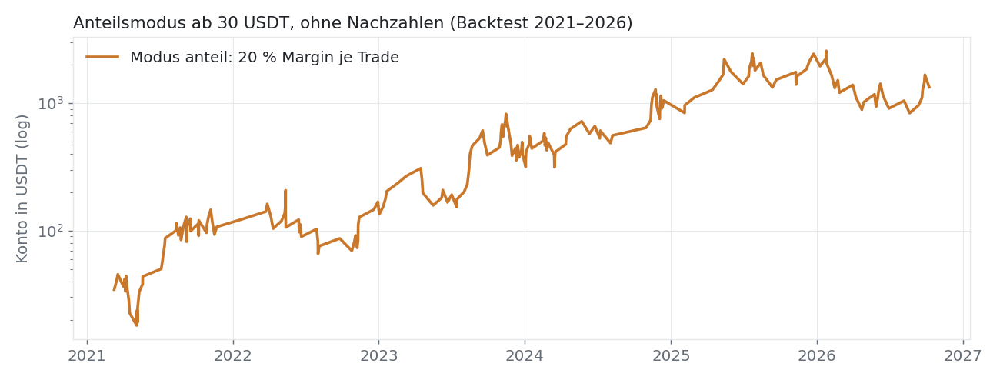

# 🎲 zockerbot – Ausbruch stark

<div align="center">


[](https://www.python.org/)


**Ein Serien-Zocker mit Sicherheitskissen: Er wartet, bis ein Coin auf Tagesbasis stark ausbricht, kauft den nächsten kurzen Einbruch auf 15 Minuten und nimmt +7,5 % Kurs mit – mit x10 sind das +74 % auf den Einsatz. Gewinne laufen in den nächsten Trade, ein Teil wandert sofort in einen Tresor, aus dem der Bot nach einer Liquidation selbst neu startet.**

[Kurzfassung](#-kurzfassung) • [Regel](#-die-regel) • [Serienmodus](#-serienmodus-b--polster) • [Ergebnisse](#-ergebnisse) • [Herleitung](#-wie-die-regel-gefunden-wurde) • [Ablauf](#-ablauf-im-live-betrieb) • [Installation](#-installation-minipc--vps) • [Bedienung](#%EF%B8%8F-bedienung) • [Risiken](#%EF%B8%8F-risiken)

</div>

---

## 🧭 Kurzfassung

- **42 Coins** auf Bitget (USDT-Perpetuals), **Long und Short**, **immer nur eine Position gleichzeitig**.
- **Einstieg** beim 15m-Rücksetzer in einem starken Tagesausbruch; **Ausstieg** nur per Take-Profit bei **+7,5 % Kurs**, Hebel **x10 isoliert**, **kein Stop-Loss** (Liquidation bei ca. 9,5 % Gegenbewegung).
- **Pro Treffer +74 %** auf die Margin, Gewinnschwelle **57,4 %** Treffer. Backtest 2021–2026: **226 Trades, 66,4 % Treffer**, längste Serie **13 Treffer in Folge**.
- **Serienmodus „B + Polster“ (Standard):** 97 % des Spielgelds je Trade; die Hälfte jedes Gewinns baut zuerst ein **Polster von 150 USDT** im Tresor auf; ab **400 USDT** Spielgeld wandert die Hälfte in den Tresor; nach einer Liquidation **füllt der Bot aus dem Tresor auf** – auf 30 USDT, mit großem Tresor auf **15 % des Kontos** (dynamischer Neustart).
- **Backtest 2021–2026, Start 30 USDT:** **123 USDT selbst eingezahlt, Konto am Ende 20.200 USDT, netto +20.077 USDT** (ohne dynamischen Neustart +3.071) – in jedem geprüften Zeitraum im Plus, auch mit Bitget-Kursen seit Mai 2026; dafür Rückgänge bis 55 % bei großem Konto.
- **Empfohlener Start:** 200 USDT einzahlen, `live.py --tresor 170` → 30 USDT spielen, 170 USDT Reserve.
- **Live = Backtest:** `live.py` und `backtest.py` nutzen dieselben Funktionen `strategy.day_flags()` und `strategy.signals()` und dieselbe Tresor-/Polster-Logik; Signale auf 42 Coins identisch mit der Forschung (2.675 von 2.675).

---

## 📐 Die Regel

| | Long | Short |
|---|---|---|
| **Tageskerze** (UTC, abgeschlossen) | RSI(14) > 75 **und** Schluss über dem Hoch der 40 Tage davor | RSI(14) < 25 **und** Schluss unter dem Tief der 40 Tage davor |
| **15m-Kerze** (abgeschlossen) | RSI(14) < 30 | RSI(14) > 70 |
| **Einstieg** | Market, direkt nach Schluss der Signal-Kerze | ebenso |
| **Take-Profit** | Einstieg + 7,5 % | Einstieg − 7,5 % |
| **Stop-Loss** | keiner – Liquidation bei ca. −9,5 % | keiner – Liquidation bei ca. +9,5 % |

**Warum das trägt:** Ein neues 40-Tage-Hoch mit Tages-RSI über 75 ist ein Ausbruch mit viel Schwung. Ein kurzer Einbruch auf 15 Minuten (RSI unter 30) wird in so einer Lage oft schnell wieder gekauft – der Kurs schafft häufiger zuerst +7,5 % als −9,5 %. Spiegelbildlich im Crash.

---

## 🎰 Serienmodus: B + Polster

So, wie man ein kleines Konto hochzockt – mit fester Regel und Sicherheitskissen:

1. **Start:** 200 USDT ins Futures-Konto und **vor dem ersten Start** einmal `.venv/bin/python3 live.py --tresor 170` – dann spielen 30 USDT, 170 USDT liegen als eigene Reserve im Tresor. (Mit nur 30 USDT ohne Reserve geht es auch.)
2. **Jeder Trade** setzt 97 % des Spielgelds ein (Spielgeld = Konto minus Tresor). **Der Tresor wird nie eingesetzt.**
3. **Polster:** Bei jedem Treffer geht die Hälfte des Gewinns sofort in den Tresor, bis dort 150 USDT plus deine eigene Reserve liegen. So bezahlt der Bot Neustarts schon nach wenigen Treffern selbst.
4. **Ziel:** Erreicht das Spielgeld 400 USDT, bleibt die Hälfte (mindestens der Neustart-Betrag) im Spiel, der Rest wandert in den Tresor – ohne Pause geht es weiter. Mit 50 % im Spiel reichen danach 2 Treffer bis zum nächsten Ziel.
5. **Liquidation:** Der Bot füllt das Spielgeld aus dem Tresor wieder auf den **Neustart-Betrag** auf und startet die nächste Serie. Einzahlen musst du nur, wenn der Tresor leer ist.
6. **Dynamischer Neustart:** Der Neustart-Betrag ist das Größere von 30 USDT und **15 % des ganzen Kontos**. Bei kleinem Konto bleibt es bei 30 USDT; ab rund 200 USDT Konto wächst er mit. Mit großem Tresor setzt der Bot so je Trade etwa 15 % des Kontos ein und sichert jeden Gewinn sofort.
7. **Abheben jederzeit** (ohne offene Position): Der Bot erkennt den kleineren Kontostand und verkleinert Tresor und Reserve, 30 USDT Spielgeld bleiben stehen.

Telegram meldet jeden Einstieg, jeden Treffer mit Serienstand und Polster-Anteil („TREFFER 3 in Folge … 10,80 USDT ins Polster“), jede Liquidation, jedes erreichte Ziel, jedes Auffüllen aus dem Tresor und erkannte Abhebungen.

<picture>
  <source media="(prefers-color-scheme: dark)" srcset="docs/serie_dark.png">
  
</picture>

### Warum B + Polster

Vier Einstellungen auf denselben Trades (Start 30 USDT; netto = Tresor + Spielgeld − eigene Einzahlungen; je Zeitraum frisch gestartet):

| Einstellung | 2021–2023 | 2024 – 04/2026 | 05–11/2026 (Bitget) | 2021–2026 | selbst eingezahlt |
|---|---|---|---|---|---|
| A: Ziel 1.000, 20 % im Spiel | +4.256 | +1.444 | −112 | **+5.552** | 226 USDT |
| B: Ziel 400, 50 % im Spiel | +2.682 | +645 | −112 | +3.398 | 226 USDT |
| B + Polster 150, Neustart fest 30 | +2.356 | +480 | +20 | +3.071 | 123 USDT |
| **B + Polster 150, Neustart 15 % (Standard)** | **+5.248** | **+525** | **+20** | **+20.077** | **123 USDT** |

- **A** bringt langfristig am meisten, braucht bis zum ersten Ziel aber im Median 182 und im schlimmsten Fall rund 700 USDT eigene Einzahlung – und hat seit März 2025 das Ziel nie erreicht.
- **B + Polster** ist als einzige Einstellung in jedem Zeitraum im Plus und braucht die wenigste eigene Einzahlung.
- **Dynamischer Neustart 15 %** macht daraus langfristig ein Vielfaches: Kontostand Jahresende 2022 +61 %, 2023 +115 %, 2024 +129 %, 2025 +99 %, 2026 bisher −29 %; größter Rückgang ab 1.000 USDT Konto 55 %. Bei frischem Start mit kleinem Konto ändert er nichts (2024–04/2026 frisch: +525 statt +480; 200 USDT ab Mai: gleich). Läuft der Bot schon mit großem Konto, brachte Mai bis heute +27 % (fest 30: +2 %). 10 % wären vorsichtiger (+9.466, Rückgang 57 %), 20 % kaum besser als 15 %, aber mit 67 % Rückgang.
- **200 USDT am 1. Mai 2026** (30 Spiel + 170 Reserve, Bitget-Kurse): A und B heute 88 USDT, **B + Polster 220 USDT** – das Konto fiel dabei nie unter 153 USDT.
- **Kleinere oder größere Ziele** (150 bis 2.000) und andere Anteile im Spiel wurden ebenfalls gerechnet: kleinere Ziele sind stetiger, größere bringen langfristig mehr, wechseln aber je Zeitraum die Rangfolge; Ziel 2.000 wurde 2024–2026 nie erreicht.

---

## 📏 Modus „anteil“

Alternative ohne Tresor: Jeder Trade setzt `margin_fraction` (Standard 20 %) des Kontos ein, kein Nachzahlen.

<picture>
  <source media="(prefers-color-scheme: dark)" srcset="docs/anteil_dark.png">
  
</picture>

| Margin je Trade | 30 USDT → (2021–2026) | größter Rückgang |
|---|---|---|
| 10 % | 460 | 41 % |
| 15 % | 972 | 56 % |
| **20 %** | **1.336** | **68 %** |
| 25 % | 1.167 | 79 % |
| 30 % | 627 | 88 % |

Seit 01.05.2026 (Bitget-Kurse) mit 20 %: 30 → 39 USDT.

---

## 📊 Ergebnisse

<picture>
  <source media="(prefers-color-scheme: dark)" srcset="docs/jahre_dark.png">
  
</picture>

| Jahr | 2021 | 2022 | 2023 | 2024 | 2025 | 2026 |
|---|---|---|---|---|---|---|
| Trades | 51 | 33 | 48 | 40 | 27 | 27 |
| Trefferquote | 69 % | 64 % | 67 % | 70 % | 70 % | 56 % |

- 226 Trades, davon 165 Long und 61 Short; im Schnitt rund 40 Trades pro Jahr.
- **Seit 01.05.2026 mit Bitget-Kursen** (`backtest.py --von 2026-05-01`): 15 Trades, 66,7 % Treffer, längste Serie 4 – B + Polster netto +20 USDT.

Backtest auf Binance-Futures-Kerzen (15m) von 42 Coins, Januar 2021 bis Oktober 2026, eine Position gleichzeitig, Einstieg zur Eröffnung der nächsten 15m-Kerze, TP und Liquidation auf 15m-Hoch/Tief (erreicht eine Kerze beides, zählt es als Liquidation), Gebühren abgezogen. Gegenprobe mit Bitget-Kerzen über `backtest.py`.

---

## 🔬 Wie die Regel gefunden wurde

1. **42 Coins, 2.160 Varianten** der Ausbruchs-Regel (15m-RSI-Schwelle, Tages-RSI, Donchian-Länge, Marktphasen-Filter, Hebel x10/15/20, TP 3–10 %).
2. **Aufteilung gegen Zufallstreffer:** Coins zufällig in zwei Gruppen; ausgewählt wurde nur auf Gruppe A in 2021–2023, geprüft auf Gruppe A 2024–2026 und auf Gruppe B.
3. Die meisten guten Varianten aus 2021–2023 kippten danach. **„Ausbruch stark“ (75/40, x10, TP 7,5 %) hielt:** 66,7 % Treffer 2021–2023, 66,0 % 2024–2026, Nachbarn mit 10 und 20 Tagen Donchian ähnlich.
4. **Serien:** Im ganzen Suchraum gab es 217 Serien mit mindestens 10 Treffern in Folge à über +50 %. Serien kommen bei einer Trefferquote um 66 % immer wieder vor, sind aber nicht vorhersagbar.
5. **Cockpit-Zonen** (Treppe/Aufzug/Rückprall) als Filter: je Signal besser, mit nur einer Position gleichzeitig aber kein höheres Konto; TP in Tages-σ schlechter – nicht eingebaut.
6. **Mehrere Regeln gleichzeitig:** Zusatzregeln kippten auf Gruppe A 2024–2026 ins Minus – nicht eingebaut.
7. **Hebel und TP:** x20 mit TP 7,5 % trifft nur 46 %, die Serien reißen ab; x15 mit TP 10 % knapp schlechter; x10 mit TP 7,5 % bleibt am besten.
8. **Bitget-Trailing-Stop statt festem TP** (1m-Kerzen, 8 Coins): früh aktiviert weniger je Trade, ab +7,5 % gleichwertig – fester TP bleibt.
9. **Verluste seit Mai 2026 untersucht:** Sperre für erneuten Einstieg im selben Coin, Alter und Überdehnung des Ausbruchs, BTC-Richtung – alles in 2021–2023 widerlegt oder schädlich. Die Trefferquote seit Mai ist normal; es fehlte nur eine lange Serie. Daraus entstanden Tresor, kleineres Ziel und Polster.
10. **Dynamischer Neustart** (2,5–20 % des Kontos, Ziel fest oder mitwachsend): Ziel fest bei 400 und 15–20 % lagen in 2021–2023 vorn (+5.248 / +5.284); 15 % gewählt wegen deutlich geringerer Rückgänge. Ein mitwachsendes Ziel war durchweg schlechter.

Skripte und Ergebnisse: [`forschung/`](forschung/).

---

## 🔁 Ablauf im Live-Betrieb

Alle 15 Minuten, 20 Sekunden nach Kerzenschluss:

1. **Offene Position:** Steht der Take-Profit auf Bitget? Fehlt er, wird er neu gesetzt.
2. **Position verschwunden:** Ergebnis feststellen (TP oder Liquidation), übrige Orders stornieren, Serienzähler fortschreiben, bei Treffer den Polster-Anteil in den Tresor buchen, in `data/trades.csv` eintragen, Telegram.
3. **Tresor** (nur ohne offene Position): Abhebung erkennen, bei erreichtem Ziel die Hälfte in den Tresor buchen, Spielgeld aus dem Tresor auf den Neustart-Betrag auffüllen (max. von 30 USDT und 15 % des Kontos); ist auch der Tresor leer → Einzahl-Meldung.
4. **Einmal pro UTC-Tag:** Tagesbedingung für alle 42 Coins aus der letzten abgeschlossenen Tageskerze.
5. **Coins mit Tagesbedingung:** 15m-Signal auf der gerade geschlossenen Kerze prüfen; bei Signal und freier Position: isolierte Margin und x10 setzen, Market-Order mit 97 % des Spielgelds, Take-Profit als reduce-only Trigger-Order zum tatsächlichen Füllkurs ± 7,5 %.

Die Order-Funktionen stammen aus dem live erprobten mbot (Hedge-Modus, `hedged=True`, reduce-only TP).

---

## 🚀 Installation (MiniPC / VPS)

```bash
git clone https://github.com/Youra82/zockerbot.git ~/zockerbot
cd ~/zockerbot
./install.sh
```

1. **Bitget:** eigenes Unterkonto, Positionsmodus **„beidseitig“ (Hedge)**, z. B. 200 USDT ins Futures-Konto.
2. **`secret.json`** ausfüllen (wird aus der Vorlage angelegt, nicht versioniert):
   ```json
   {
       "zockerbot": [{"name": "Bitget Unterkonto zockerbot", "apiKey": "...", "secret": "...", "password": "..."}],
       "telegram": {"bot_token": "...", "chat_id": "..."}
   }
   ```
3. **Eigene Reserve einbuchen – vor dem ersten Start:** `.venv/bin/python3 live.py --tresor 170` (sonst setzt der Bot das ganze Guthaben als Spielgeld ein).
4. **Prüfen ohne Orders:** `.venv/bin/python3 live.py --check` – Konto, Tresor, Spielgeld, Positionen, heutige Tagesbedingungen, aktuelle Signale.
5. **Wächter-Cronjob** (`crontab -e`):
   ```
   */5 * * * * /home/<user>/zockerbot/start.sh
   ```

Speicherbedarf unter 200 MB; je 15 Minuten werden nur die Coins mit aktiver Tagesbedingung abgefragt.

---

## ⚙️ Bedienung

| Befehl | Was er tut |
|---|---|
| `.venv/bin/python3 live.py --check` | Konto, Tresor, Spielgeld, Positionen, Tagesbedingungen, Signale – **keine Orders** |
| `.venv/bin/python3 live.py --tresor 170` | eigene Reserve in den Tresor buchen; das Polster wird zusätzlich darauf aufgebaut |
| `./start.sh` / `./stop.sh` | Bot starten / stoppen (offene Positionen und TP-Orders bleiben auf Bitget) |
| `tail -f logs/zockerbot.log` | laufendes Protokoll |
| `cat data/trades.csv` | alle abgeschlossenen Trades mit Serienstand |
| `.venv/bin/python3 backtest.py --von 2026-05-01 --tresor-start 170` | Backtest mit Bitget-Kerzen ab Datum (davor nur Indikator-Vorlauf), gleiche Signal-, Tresor- und Polster-Logik wie live, mit Trade-Liste |
| `… backtest.py --ziel 1000 --im-spiel 0.2 --polster 0 --neustart-anteil 0` | andere Einstellungen testen, ohne `settings.json` zu ändern; `--modus anteil --fraction 0.2` für den Anteilsmodus |
| `./update.sh` | neue Version holen; `settings.json`, `secret.json`, `data/`, `logs/` bleiben |

### Einstellungen (`settings.json`)

| Schlüssel | Standard | Bedeutung |
|---|---|---|
| `echtgeld.aktiv` | true | `true` = echte Orders auf Bitget, `false` = **Papierhandel** (siehe unten) |
| `echtgeld.papier_startkapital` | 200 | Startkapital des Papierkontos |
| `coins` | 42 Coins | gehandelte USDT-Perpetuals (Bitget-Namen, z. B. `PEPE`, `SHIB`) |
| `modus` | `serie` | `serie` = all-in mit Tresor, `anteil` = fester Anteil |
| `leverage` | 10 | Hebel (isolierte Margin) |
| `tp_pct` | 0.075 | Take-Profit in Kursprozent |
| `max_positionen` | 1 | höchstens so viele offene Positionen über alle Coins |
| `serie_einsatz` | 0.97 | Anteil des Spielgelds je Trade |
| `ziel_usdt` | 400 | Spielgeld, ab dem gesichert wird |
| `im_spiel_nach_ziel` | 0.50 | Anteil, der nach dem Ziel weiterspielt (Rest → Tresor) |
| `polster_usdt` | 150 | Polster: bis der Tresor diesen Betrag plus deine eigene Reserve erreicht, geht ein Teil jedes Gewinns sofort in den Tresor (0 = aus) |
| `polster_anteil` | 0.50 | Anteil jedes Gewinns, der ins Polster geht |
| `neustart_usdt` | 30 | Mindest-Neustart-Betrag (Spielgeld nach einer Liquidation) |
| `neustart_anteil` | 0.15 | dynamischer Neustart: Spielgeld wird aus dem Tresor auf mindestens diesen Anteil des Kontos aufgefüllt (0 = immer 30 USDT) |
| `margin_fraction` | 0.20 | Anteil des Kontos je Trade im Modus `anteil` |
| `min_margin_usdt` | 5.0 | darunter kein Trade |
| `strategy` | 14 / 40 / 75 / 25 / 30 / 70 | RSI-Länge, Donchian-Tage, Tages-RSI Long/Short, 15m-RSI Long/Short |

### 📝 Papierhandel

In `settings.json` `"echtgeld": {"aktiv": false}` setzen → der Bot handelt dieselbe Regel nur auf Papier:
echte Bitget-Kurse (öffentlich, **kein Schlüssel nötig**), Einstieg/Ausstieg zum letzten Kurs ± 0,05 % Spread,
0,06 % Gebühr je Seite, TP und Liquidation werden mit 1m-Kerzen abgerechnet (`papier.py`).

- Eigene Daten in `data_papier/` (Konto `konto.json`, Zustand mit Tresor/Serie, `trades.csv`) – Echtgeld bleibt in `data/`.
- Der Schalter wird **vor jedem 15m-Takt neu gelesen**: umschalten ohne Neustart, Telegram meldet den Wechsel,
  Papier-Meldungen beginnen mit „📝 PAPIER“.
- Beim Wechsel auf Papier laufen offene Echtgeld-Positionen mit ihrem TP auf Bitget weiter.
- Das **Cockpit** liest denselben Schalter und zeigt automatisch Papierkonto oder Bitget-Konto.
- `update.sh` behält deine `settings.json` und ergänzt nur neue Einträge.
- Offline-Prüfung des Papierkontos: `python3 tests_papier.py`

---

## 📁 Dateien

```
zockerbot/
├── strategy.py          Signalfunktion (Live und Backtest identisch)
├── live.py              15-Minuten-Takt, Orders, Tresor/Polster, Telegram, Zustand
├── exchange.py          Bitget-Anbindung (aus dem mbot)
├── backtest.py          Backtest mit Bitget-Kerzen, gleiche Logik wie live
├── settings.json        Einstellungen
├── secret.json.template Vorlage für Schlüssel
├── install.sh  start.sh  stop.sh  update.sh
├── docs/                Grafiken + make_charts.py
└── forschung/           Suche, Gegenproben, Varianten, Ergebnisse (eigene README)
```

---

## ⚠️ Risiken

- **Kein Stop-Loss:** Ein Fehltreffer kostet die gesamte Margin dieses Trades – also das ganze Spielgeld. Der Tresor wird nie direkt eingesetzt, finanziert aber jeden Neustart.
- **Dynamischer Neustart:** Mit großem Konto setzt jeder Trade rund 15 % des Kontos; vier Liquidationen in Folge kosten dann etwa die Hälfte. Im Backtest fiel das Konto ab 1.000 USDT um bis zu 55 %, 2026 bisher −29 %.
- **Serien sind Glück:** Ob ein Ziel fällt, hängt an einzelnen Trades – seit Mai 2026 entschied ein länger laufender Trade, ob eine 4er- oder 5er-Serie entstand. Jede Liquidation kostet den Tresor rund 29 USDT für den Neustart.
- **2026 schwächer:** 56 % Treffer bei 27 Trades (Binance-Kurse), knapp unter der Gewinnschwelle von 57,4 %; mit Bitget-Kursen seit Mai 66,7 %.
- **Backtest ≠ Zukunft:** Die Regel wurde aus vielen Varianten ausgewählt und gegengeprüft; der Vorteil von einigen Prozentpunkten Trefferquote kann verschwinden. Liquidationsabstand, Funding und Slippage auf Bitget können vom Backtest abweichen. Eine echte Order wurde vor dem ersten Live-Start noch nicht gesendet – den ersten Trade auf Bitget und in Telegram genau ansehen.
