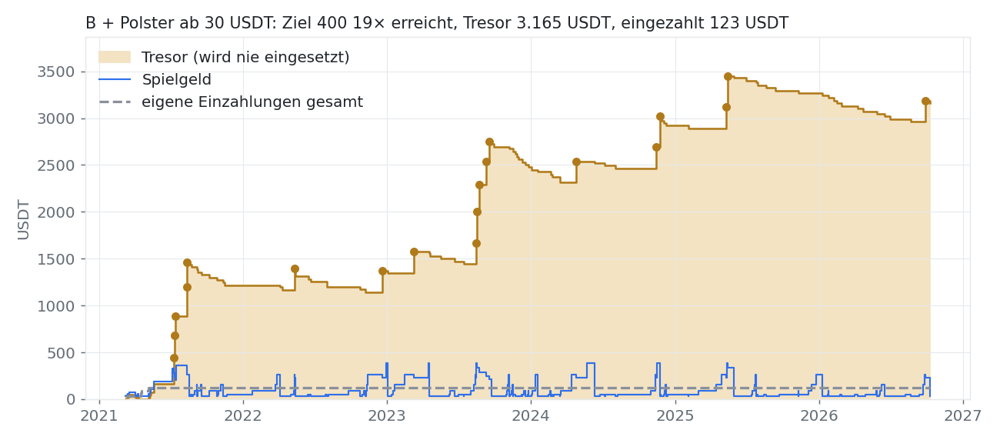
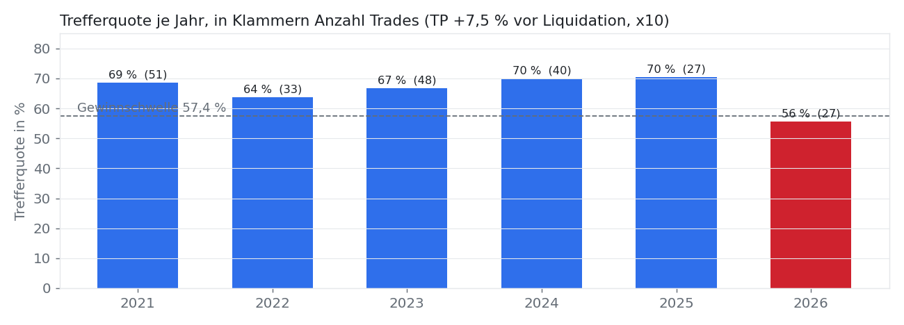

# 🎲 zockerbot – Ausbruch stark

<div align="center">


[](https://www.python.org/)


**Ein Serien-Zocker: Er wartet, bis ein Coin auf Tagesbasis stark ausbricht, kauft den nächsten kurzen Einbruch auf 15 Minuten und nimmt +7,5 % Kurs mit. Mit x10 sind das +74 % auf den Einsatz pro Treffer. Im Serienmodus läuft jeder Gewinn voll in den nächsten Trade.**

[Regel](#-die-regel) • [Serienmodus](#-modus-serie) • [Ergebnisse](#-ergebnisse) • [Wie die Regel gefunden wurde](#-wie-die-regel-gefunden-wurde) • [Ablauf](#-ablauf-im-live-betrieb) • [Installation](#-installation-minipc--vps) • [Bedienung](#%EF%B8%8F-bedienung) • [Risiken](#%EF%B8%8F-risiken)

</div>

---

## 🧭 Kurzfassung

- **42 Coins** auf Bitget (USDT-Perpetuals), **immer nur eine Position gleichzeitig**.
- **Einstieg** beim 15m-Rücksetzer in einem starken Tagesausbruch, Long oder Short.
- **Ausstieg** nur per Take-Profit bei **+7,5 % Kurs**, Hebel **x10 isoliert**, **kein Stop-Loss** (Liquidation bei ca. 9,5 % Gegenbewegung).
- **Pro Treffer +74 %** auf die Margin, Gewinnschwelle **57,4 %** Treffer. Backtest 2021–2026: **66,1 %** Treffer, 224 Trades, längste Serie **12 Treffer in Folge**.
- **Zwei Modi:** `serie` (all-in mit Zinseszins bis zum Ziel, dann Auszahlungs-Meldung) oder `anteil` (fester Anteil des Kontos je Trade).
- **Live = Backtest:** `live.py` und `backtest.py` nutzen dieselben Funktionen `strategy.day_flags()` und `strategy.signals()`; auf 42 Coins identisch mit der Forschung (2.675 von 2.675 Signalen).

---

## 📐 Die Regel

| | Long | Short |
|---|---|---|
| **Tageskerze** (UTC, abgeschlossen) | RSI(14) > 75 **und** Schluss über dem Hoch der 40 Tage davor | RSI(14) < 25 **und** Schluss unter dem Tief der 40 Tage davor |
| **15m-Kerze** (abgeschlossen) | RSI(14) < 30 | RSI(14) > 70 |
| **Einstieg** | Market, direkt nach Schluss der Signal-Kerze | ebenso |
| **Take-Profit** | Einstieg + 7,5 % | Einstieg − 7,5 % |
| **Stop-Loss** | keiner – Liquidation bei ca. −9,5 % | keiner – Liquidation bei ca. +9,5 % |

**Warum das trägt:** Ein neues 40-Tage-Hoch mit Tages-RSI über 75 ist ein Ausbruch mit viel Schwung. Ein kurzer Einbruch auf 15 Minuten (RSI unter 30) wird in so einer Lage oft schnell wieder gekauft – der Kurs schafft häufiger zuerst +7,5 % als −9,5 %. Spiegelbildlich im Crash.

---

## 🎰 Modus „serie“

So, wie man ein kleines Konto hochzockt – nur mit fester Regel:

1. Start mit z. B. **30 USDT** im Futures-Konto.
2. Jeder Trade setzt **97 % des freien Guthabens** als Margin ein. Sieben Treffer in Folge machen aus 30 → 52 → 89 → 153 → 263 → 452 → 777 → 1.336 USDT.
3. Ab **`ziel_usdt`** (Standard 1.100 USDT ≈ 1.000 €) eröffnet der Bot **keine neuen Trades** und schickt per Telegram: *Ziel erreicht – jetzt abheben*. Nach dem Abheben: `.venv/bin/python3 live.py --weiter`.
4. Wird eine Position liquidiert, ist das Konto leer – der Bot meldet sich, und nach einer neuen Einzahlung beginnt die nächste Serie.

Jede Telegram-Nachricht nennt den Stand der Serie („TREFFER 6 in Folge“).

<picture>
  <source media="(prefers-color-scheme: dark)" srcset="docs/serie_dark.png">
  
</picture>

| Ziel (`ziel_usdt`) | erreicht 2021–2026 | eingezahlt (je 30 USDT) | ausgezahlt |
|---|---|---|---|
| 600 | 8× | 2.550 USDT | 6.707 USDT |
| **1.100** (Standard) | **4×** (07/2021, 08/2023, 11/2024, 05/2025) | **2.430 USDT** | **5.841 USDT** |
| 5.000 | 1× (07/2021) | 2.340 USDT | 7.720 USDT |

Im Serienmodus wird **sehr oft neu eingezahlt** (rund 80 Mal in knapp 6 Jahren) – die Auszahlungen kommen aus wenigen langen Serien.

## 📏 Modus „anteil“

Jeder Trade setzt `margin_fraction` (Standard 20 %) des Kontos ein, kein Nachzahlen.

<picture>
  <source media="(prefers-color-scheme: dark)" srcset="docs/anteil_dark.png">
  
</picture>

| Margin je Trade | 30 USDT → (2021–2026) | größter Rückgang |
|---|---|---|
| 10 % | 398 | 43 % |
| 15 % | 787 | 58 % |
| **20 %** | **1.013** | **71 %** |
| 25 % | 830 | 80 % |
| 30 % | 419 | 87 % |

---

## 📊 Ergebnisse

<picture>
  <source media="(prefers-color-scheme: dark)" srcset="docs/jahre_dark.png">
  
</picture>

| Jahr | 2021 | 2022 | 2023 | 2024 | 2025 | 2026 |
|---|---|---|---|---|---|---|
| Trades | 49 | 35 | 46 | 40 | 27 | 27 |
| Trefferquote | 67 % | 63 % | 67 % | 68 % | 70 % | 59 % |

Backtest auf Binance-Futures-Kerzen (15m) von 42 Coins, Januar 2021 bis Oktober 2026, eine Position gleichzeitig, Einstieg zur Eröffnung der nächsten 15m-Kerze, TP und Liquidation auf 15m-Hoch/Tief (erreicht eine Kerze beides, zählt es als Liquidation), Gebühren abgezogen.

---

## 🔬 Wie die Regel gefunden wurde

1. **42 Coins, 2.160 Varianten** der Ausbruchs-Regel (15m-RSI-Schwelle, Tages-RSI, Donchian-Länge, Marktphasen-Filter, Hebel x10/15/20, TP 3–10 %).
2. **Aufteilung gegen Zufallstreffer:** Coins zufällig in zwei Gruppen; ausgewählt wurde nur auf Gruppe A in 2021–2023, geprüft auf Gruppe A 2024–2026 und auf Gruppe B.
3. Die meisten guten Varianten aus 2021–2023 kippten danach. **„Ausbruch stark“ (75/40, x10, TP 7,5 %) hielt:** 66,7 % Treffer 2021–2023, 66,0 % 2024–2026, Nachbarn mit 10 und 20 Tagen Donchian ähnlich.
4. **Serien:** Im ganzen Suchraum gab es 217 Serien mit mindestens 10 Treffern in Folge à über +50 %. Welche Variante gerade eine Serie hat, wechselt – Serien kommen bei einer Trefferquote um 66 % immer wieder vor, sind aber nicht vorhersagbar.
5. **Cockpit-Zonen** (Treppe/Aufzug/Rückprall) als Filter getestet: Je Signal treffen Einstiege nach einem schon laufenden Rücksetzer-Bein öfter (69/73 % statt 60/58 %), mit nur einer Position gleichzeitig bringt der Filter aber kein höheres Konto – deshalb nicht eingebaut. TP in Tages-σ statt fest 7,5 % war schlechter.

Skripte und Ergebnisse: [`forschung/`](forschung/).

---

## 🔁 Ablauf im Live-Betrieb

Alle 15 Minuten, 20 Sekunden nach Kerzenschluss:

1. **Offene Position:** steht der Take-Profit auf Bitget? Fehlt er, wird er neu gesetzt.
2. **Position verschwunden:** Ergebnis feststellen (TP oder Liquidation), übrige Orders stornieren, Serienzähler fortschreiben, in `data/trades.csv` eintragen, Telegram.
3. **Ziel / leeres Konto** (Modus serie): Ziel erreicht → Pause und Abhebe-Meldung; Konto leer → Einzahl-Meldung.
4. **Einmal pro UTC-Tag:** Tagesbedingung für alle 42 Coins aus der letzten abgeschlossenen Tageskerze.
5. **Coins mit Tagesbedingung:** 15m-Signal auf der gerade geschlossenen Kerze prüfen; bei Signal und freier Position: isolierte Margin und x10 setzen, Market-Order, Take-Profit als reduce-only Trigger-Order zum tatsächlichen Füllkurs ± 7,5 %.

Die Order-Funktionen stammen aus dem live erprobten mbot (Hedge-Modus, `hedged=True`, reduce-only TP).

---

## 🚀 Installation (MiniPC / VPS)

```bash
git clone https://github.com/Youra82/zockerbot.git ~/zockerbot
cd ~/zockerbot
./install.sh
```

1. **Bitget:** eigenes Unterkonto mit USDT im Futures-Konto, Positionsmodus **„beidseitig“ (Hedge)**.
2. **`secret.json`** ausfüllen (wird aus der Vorlage angelegt, nicht versioniert):
   ```json
   {
       "zockerbot": [{"name": "Bitget Unterkonto zockerbot", "apiKey": "...", "secret": "...", "password": "..."}],
       "telegram": {"bot_token": "...", "chat_id": "..."}
   }
   ```
3. **Prüfen ohne Orders:** `.venv/bin/python3 live.py --check` – Konto, Positionen, heutige Tagesbedingungen, aktuelle Signale.
4. **Wächter-Cronjob** (`crontab -e`):
   ```
   */5 * * * * /home/<user>/zockerbot/start.sh
   ```

Speicherbedarf unter 200 MB; je 15 Minuten werden nur die Coins mit aktiver Tagesbedingung abgefragt.

---

## ⚙️ Bedienung

| Befehl | Was er tut |
|---|---|
| `.venv/bin/python3 live.py --check` | Konto, Positionen, Tagesbedingungen, Signale – **keine Orders** |
| `.venv/bin/python3 live.py --weiter` | nach erreichtem Ziel weitermachen (Serienzähler auf 0) |
| `./start.sh` / `./stop.sh` | Bot starten / stoppen (offene Positionen und TP-Orders bleiben auf Bitget) |
| `tail -f logs/zockerbot.log` | laufendes Protokoll |
| `cat data/trades.csv` | alle abgeschlossenen Trades mit Serienstand |
| `.venv/bin/python3 backtest.py --days 365` | Backtest mit Bitget-Kerzen, gleiche Signalfunktion wie live |
| `./update.sh` | neue Version holen; `settings.json`, `secret.json`, `data/`, `logs/` bleiben |

### Einstellungen (`settings.json`)

| Schlüssel | Standard | Bedeutung |
|---|---|---|
| `coins` | 42 Coins | gehandelte USDT-Perpetuals (Bitget-Namen, z. B. `PEPE`, `SHIB`) |
| `modus` | `serie` | `serie` = all-in mit Ziel, `anteil` = fester Anteil |
| `leverage` | 10 | Hebel (isolierte Margin) |
| `tp_pct` | 0.075 | Take-Profit in Kursprozent |
| `max_positionen` | 1 | höchstens so viele offene Positionen über alle Coins |
| `serie_einsatz` | 0.97 | Anteil des freien Guthabens je Trade im Modus `serie` |
| `ziel_usdt` | 1100 | ab diesem Kontostand pausiert der Modus `serie` |
| `margin_fraction` | 0.20 | Anteil des Kontos je Trade im Modus `anteil` |
| `min_margin_usdt` | 5.0 | darunter kein Trade |
| `strategy` | 14 / 40 / 75 / 25 / 30 / 70 | RSI-Länge, Donchian-Tage, Tages-RSI Long/Short, 15m-RSI Long/Short |

---

## ⚠️ Risiken

- **Kein Stop-Loss:** Ein Fehltreffer kostet die gesamte Margin dieses Trades – im Modus `serie` also das ganze Konto.
- **Serien sind Glück:** Bei 66 % Trefferquote liegt die Chance auf 7 Treffer in Folge (30 → über 1.100 USDT) bei rund 5 % pro Start; der Backtest brauchte dafür im Schnitt etwa 20 neue Einzahlungen je erreichtem Ziel.
- **2026 schwächer:** 59 % Treffer bei 27 Trades, knapp über der Gewinnschwelle von 57,4 %.
- **Backtest ≠ Zukunft:** Die Regel wurde aus vielen Varianten ausgewählt und gegengeprüft; der Vorteil von einigen Prozentpunkten Trefferquote kann verschwinden. Liquidationsabstand, Funding und Slippage auf Bitget können vom Backtest abweichen.
