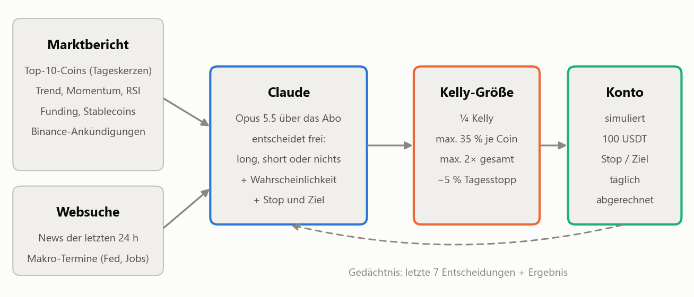
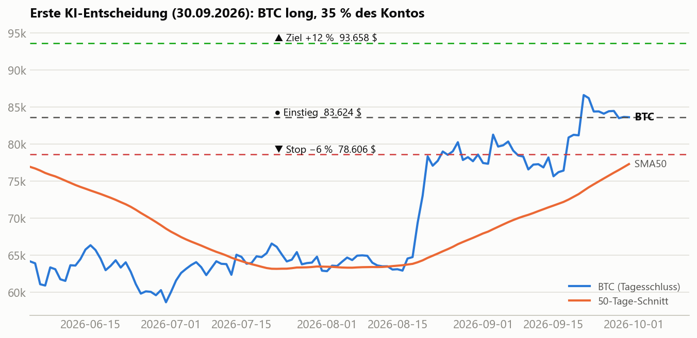
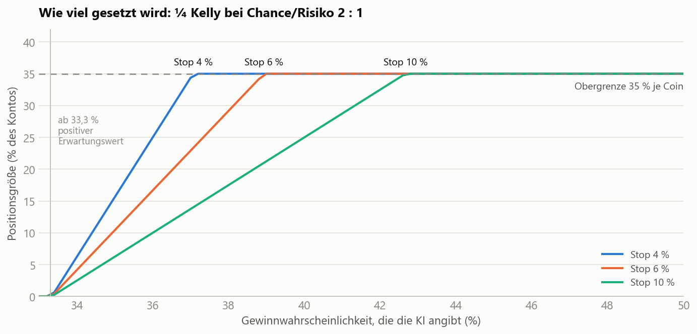
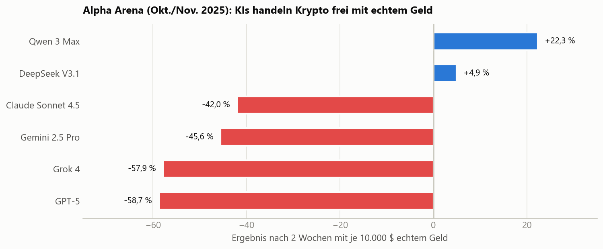

# 🎲 zockerbot – der KI-Spekulant

<div align="center">


[](https://www.python.org/)


**Ein Trading-Bot ohne feste Regeln: Jeden Tag liest eine KI den Markt, sucht selbst nach News, entscheidet frei über long, short oder Abwarten – und muss für jede Idee eine ehrliche Wahrscheinlichkeit nennen. Wie viel gesetzt wird, bestimmt nicht die KI, sondern die Kelly-Formel.**

[Übersicht](#-übersicht) • [Ablauf](#-ablauf) • [Eine echte Entscheidung](#-eine-echte-entscheidung) • [Einsatzhöhe](#-einsatzhöhe-kelly-formel) • [Ehrliche Einordnung](#%EF%B8%8F-ehrliche-einordnung) • [Installation](#-installation-minipc) • [Bedienung](#%EF%B8%8F-bedienung)

</div>

---

## 📊 Übersicht

Der zockerbot ist ein Experiment: **Kann eine KI, die wie ein disziplinierter Profi-Spekulant denkt, einfaches BTC-Halten schlagen?** Er handelt (simuliert) Perpetual-Futures auf den zehn größten Coins und startet mit 100 USDT im Dry-Run – es werden **keine echten Orders** gesendet.

### 🧭 Kurzfassung
- **Die KI entscheidet frei** – long, short oder gar nichts. Keine festen Indikator-Regeln.
- **Einmal pro Tag** nach Tagesschluss (00:00 UTC), auf Basis abgeschlossener Tageskerzen.
- **Sie recherchiert selbst**: Krypto-News der letzten 24 Stunden und Makro-Termine (Fed, Inflation, Arbeitsmarkt).
- **Sie lernt aus ihrer Vergangenheit**: Die letzten 7 Entscheidungen samt Ergebnis gehören zu jedem Auftrag.
- **Die Einsatzhöhe kommt aus der Mathematik**, nicht aus dem Bauchgefühl: ¼ Kelly mit harten Obergrenzen.
- **Über das Claude-Abo**: keine API-Kosten, die KI hat nur Websuche – sie kann auf dem Rechner nichts ausführen.

---

## 🔁 Ablauf

<picture>
  <source media="(prefers-color-scheme: dark)" srcset="docs/flow_dark.png">
  
</picture>

1. **Marktbericht** (`data.py`): Für jeden der zehn Coins Renditen über 1/7/30/90 Tage, Abstand zu den 20-/50-/100-Tage-Durchschnitten, RSI, Schwankung, Tagesspanne und Funding. Dazu das BTC-Regime, das Wachstum der Stablecoin-Menge und neue Binance-Ankündigungen. Nur **abgeschlossene** Kerzen – die laufende wird verworfen.
2. **Websuche**: Höchstens 4 Suchen nach News und anstehenden Terminen. Riskante Termine kurz vor dem nächsten Tag sind ein Grund für kleinere Positionen.
3. **Claude entscheidet** (`brain.py`): je Idee Coin, Richtung, **Gewinnwahrscheinlichkeit**, Chance/Risiko, Stop, Ziel und Begründung – als streng geprüftes JSON.
4. **Kelly-Formel** (`logic.py`): rechnet daraus die Positionsgröße und wendet die Leitplanken an.
5. **Konto** (`live.py`): Positionen werden zum Tagesschlusskurs gesetzt, am nächsten Tag über Hoch/Tief auf Stop und Ziel geprüft (Stop zuerst – konservativ), Funding und Gebühren werden abgezogen.

---

## 🔍 Eine echte Entscheidung

<picture>
  <source media="(prefers-color-scheme: dark)" srcset="docs/decision_dark.png">
  
</picture>

Die erste Entscheidung (30.09.2026): **BTC long und ETH long, je 35 % des Kontos.** Aus der Begründung der KI:

> *„Das Umfeld spricht für Trendfolge: BTC liegt deutlich über seinen Durchschnitten, die Stablecoin-Menge wächst und stützt den Trend, der RSI liegt bei rund 60 – nicht überhitzt. Die Altcoins mit dem stärksten Momentum (AVAX, LINK, ADA) liegen schon 12–15 % über ihrem 20-Tage-Schnitt und sind sehr volatil – dort jagt man dem Kurs eher hinterher. Deshalb setze ich auf die liquiden Trendführer BTC und ETH, mit weiten Stops passend zum Tagesrauschen.“*

| | BTC | ETH |
|---|---|---|
| Gewinnwahrscheinlichkeit (Schätzung der KI) | 46 % | 44 % |
| Chance/Risiko | 2 : 1 | 2 : 1 |
| Stop / Ziel | −6 % / +12 % | −7,5 % / +15 % |

Mit Websuche fand die KI im Testlauf selbst den ETF-Abfluss vom Vortag und den anstehenden US-Arbeitsmarktbericht – und setzte deshalb **engere Stops**. Jede Entscheidung wird vollständig in `data_dryrun/decisions.jsonl` protokolliert.

---

## 📐 Einsatzhöhe (Kelly-Formel)

<picture>
  <source media="(prefers-color-scheme: dark)" srcset="docs/kelly_dark.png">
  
</picture>

Profi-Spieler setzen nicht nach Gefühl, sondern nach der **Kelly-Formel**: `f* = p − (1 − p) / b` (p = Gewinnwahrscheinlichkeit, b = Chance/Risiko). Der zockerbot setzt nur **ein Viertel** davon und rechnet es auf den Stop-Abstand um:

`Positionsgröße = ¼ · f* / Stop-Abstand`

- **Kein positiver Erwartungswert → kein Einsatz.** Bei 2 : 1 lohnt sich ein Trade erst ab 33,3 % Trefferwahrscheinlichkeit.
- **Weiter Stop → kleinere Position**, damit das Risiko je Trade gleich bleibt.
- **Überschätzt die KI ihre Chancen, kostet sie das direkt Geld** – deshalb soll sie kalibriert schätzen statt mutig.

### 🛡️ Leitplanken

| Regel | Wert |
|---|---|
| Anteil der Kelly-Quote | 25 % |
| Höchste Position je Coin | 35 % des Kontos |
| Gesamt-Exposure | höchstens 2× |
| Tagesverlust-Stopp | −5 % → alles schließen, 1 Tag Pause |
| Stop-Abstand | 0,5 % bis 50 %, sonst wird die Idee verworfen |
| Positionen, die die KI nicht erneut nennt | werden geschlossen |

---

## ⚠️ Ehrliche Einordnung

<picture>
  <source media="(prefers-color-scheme: dark)" srcset="docs/arena_dark.png">
  
</picture>

- **KIs sind keine Gelddruckmaschinen.** Im öffentlichen Wettbewerb „Alpha Arena“ handelten sechs führende Modelle zwei Wochen lang mit je 10.000 $ echtem Geld – vier verloren 42–59 %. Der Bestplatzierte hatte nach zwei Wochen +22 %, zu kurz, um Können von Glück zu unterscheiden.
- **Der zockerbot hat daraus gelernt:** Die Einsatzhöhe liegt nicht bei der KI, es gibt harte Obergrenzen und einen Tagesverlust-Stopp, und die KI kennt die Ergebnisse umfangreicher eigener Tests (siehe unten).
- **Was in Tests 2023–2026 funktioniert hat und was nicht** – das steht so auch im Auftrag an die KI:
  - ✅ Trendfolge auf Tagesbasis, nur wenn BTC über seinem 100-Tage-Schnitt liegt; kleinere Positionen in unruhigen Phasen; Stablecoin-Zuflüsse als Rückenwind.
  - ❌ Scalping, häufiges Hin und Her, Shorts gegen gehypte Altcoins, Hebel auf Altcoins im Bärenmarkt, Tageszeit- und Wochentagsmuster.
- **Messlatte ist BTC halten.** In den meisten getesteten Zeiträumen war das schwer zu schlagen. Ob die KI es schafft, zeigt nur der Dry-Run über Monate.
- **Eine KI-Entscheidung lässt sich nicht fair zurücktesten**: Das Modell kennt vergangene Kurse aus dem Training. Zählen tun nur Entscheidungen ab dem Start.
- **Entscheidungen sind nicht deterministisch** – dieselben Daten können an zwei Tagen zu unterschiedlichen Ideen führen.

---

## 📋 Systemanforderungen

- **OS**: Linux (z. B. Ubuntu auf dem MiniPC); Windows funktioniert ebenfalls
- **Python**: 3.10 oder höher
- **Claude-Abo** mit Claude Code (Pro oder Max) – *oder* ein Anthropic-API-Schlüssel
- **Netzwerk**: öffentliche Binance-API, DefiLlama, Websuche über Claude

---

## 💻 Installation (MiniPC)

### 1. Repository klonen und installieren
```bash
git clone https://github.com/Youra82/zockerbot.git ~/zockerbot
cd ~/zockerbot
./install.sh
```

### 2. Claude Code einrichten (einmalig)
```bash
curl -fsSL https://claude.ai/install.sh | bash
claude        # mit dem Claude-Abo anmelden (Link im Browser/Handy bestätigen), dann /exit
```

### 3. Kostenlos testen
```bash
.venv/bin/python3 live.py --mock      # kompletter Durchlauf mit Test-Entscheidung, ohne KI
.venv/bin/python3 live.py --prompt    # zeigt den heutigen Auftrag an die KI
```

### 4. Dauerbetrieb per Cron
```bash
crontab -e
*/5 * * * * /home/matola/zockerbot/start.sh
```
`start.sh` ist ein Wächter: Läuft der Bot nicht (z. B. nach einem Neustart), startet er ihn. Verpasste Tage werden beim nächsten Start abgerechnet – für vergangene Tage trifft die KI keine nachträglichen Entscheidungen.

---

## 🕹️ Bedienung

| Aufgabe | Befehl |
|---|---|
| Live-Protokoll | `tail -f data_dryrun/zockerbot.log` |
| Alle Entscheidungen mit Begründung | `data_dryrun/decisions.jsonl` |
| Kontostand je Tag | `data_dryrun/daily.jsonl` |
| Geschlossene Trades | `data_dryrun/trades.jsonl` |
| Update | `./update.sh` (Einstellungen und Kontostand bleiben erhalten) |
| Stoppen | `./stop.sh` (und Cron-Zeile entfernen, sonst startet der Wächter neu) |

---

## ⚙️ Konfiguration (`settings.json`)

| Schlüssel | Standard | Bedeutung |
|---|---|---|
| `backend` | `abo` | `abo` = Claude Code über das Abo, `api` = Anthropic-API |
| `abo_tools` | `WebSearch` | Werkzeuge der KI; leer = keine Websuche |
| `abo_model` | *(leer)* | Modell im Abo; leer = Standard des Accounts |
| `model` / `budget_usd_per_month` | `claude-opus-5-5` / `3.0` | nur für `api`: Modell und hartes Monatsbudget |
| `effort` | `medium` | Denktiefe der KI |
| `kelly_fraction` | `0.25` | Anteil der vollen Kelly-Quote |
| `max_position` / `max_gross_leverage` | `0.35` / `2.0` | Obergrenzen je Coin / gesamt |
| `daily_loss_stop` | `0.05` | Tagesverlust, ab dem alles geschlossen wird |
| `memory_decisions` | `7` | wie viele frühere Entscheidungen die KI sieht |

Für `backend: "api"` den Schlüssel in `secret.json` ablegen: `{"anthropic_api_key": "..."}` (nicht versioniert).

---

## 📁 Projektstruktur

```
zockerbot/
├── live.py          # Ablauf: Abrechnung, Nachholen, Entscheidung, Protokoll
├── brain.py         # KI-Auftrag, Aufruf (Abo oder API), Antwortprüfung, Kosten
├── data.py          # Marktbericht aus öffentlichen Daten
├── logic.py         # Kelly-Größe, Tagesabrechnung, Umschichten
├── settings.json    # Einstellungen
├── install.sh / start.sh / stop.sh / update.sh
└── docs/            # Grafiken + generate_illustrations.py
```

---

<div align="center">

**⚠️ Keine Anlageberatung.** Der zockerbot ist ein Experiment im Dry-Run. Krypto-Futures mit Hebel können zum Totalverlust führen.

</div>
